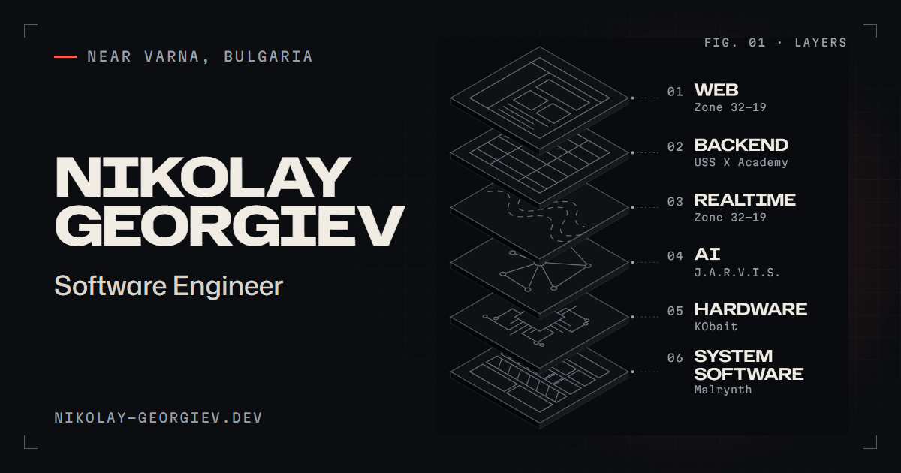

<a href="https://nikolay-georgiev.dev">
  
</a>

<h1 align="center">nikolay-georgiev.dev</h1>

<p align="center">
  The source of my portfolio: case studies, a lab, a setup page and a CV that builds itself.<br>
  <a href="https://nikolay-georgiev.dev"><b>Visit the site</b></a> ·
  <a href="https://nikolay-georgiev.dev/bg">На български</a> ·
  <a href="https://nikolay-georgiev.dev/cv">CV</a> ·
  <a href="https://www.linkedin.com/in/nikolaygeorgiev0049/">LinkedIn</a>
</p>

<p align="center">
  <a href="https://github.com/macmma322/nikolay-georgiev.dev/actions/workflows/ci.yml"></a>
  
  
  
  
</p>

---

I build production platforms, intelligent systems, embedded hardware and
low-level software. This repository is the site that shows that work. It is a
static Astro site, built to the same standard as the projects it describes.
Every claim on it comes from the project repositories, and every project states
its real status, whether that is live, active or only planned.

## What's in it

| Page            | What you find                                                                                                 |
| --------------- | ------------------------------------------------------------------------------------------------------------- |
| **Work**        | Seven case studies, from web platforms and a Unity game to an OS kernel, each with a drawn plate and diagrams |
| **Lab**         | Tooling, planned systems and paused ideas, labelled honestly                                                  |
| **Open source** | The MIT-licensed `CLAUDE.md` engineering blueprint and curated upstream credits                               |
| **Setup**       | Interactive explorers of the hardware, the environment and the decisions behind them                          |
| **CV**          | A one-page CV in English and Bulgarian, generated as PDF at build time                                        |
| **Contact**     | An enquiry form whose replies are handled by the mail agent below                                             |

## Engineering highlights

- **HTML first, no client framework.** Every page is static HTML. Small
  scripts handle the enquiry form, the menu and the copy buttons. three.js
  loads only on `/setup`, for the 3D explorers.
- **A strict CSP that holds.** Astro's built-in CSP hashes every script and
  style, and the site has no inline `style` attributes anywhere.
- **Translations the compiler checks.** Every interface string is an
  `{ en, bg }` pair, so a missing Bulgarian string fails the typecheck. The
  build also rejects `undefined`, `${` or Bulgarian text leaking into an
  English page.
- **Diagrams as data.** Architecture diagrams are typed nodes and edges, laid
  out on a grid with orthogonal edge routing (`src/lib/diagram.ts`).
- **A CV that builds itself.** `pdf-lib` writes the PDFs from the same data as
  the pages, and `npm run cv:inspect` reads them back to check pages, fonts and
  links.
- **The build checks its own output.** `scripts/audit-dist.mjs` scans the
  built site for leaked secrets, local paths, broken links, SEO and
  accessibility basics, and fails the build if it finds any.
- **Tested like a product.** Playwright and axe run against the production
  build on desktop, phone and tablet.
- **Hardened delivery.** Caddy serves the site with HSTS, COOP,
  `frame-ancestors 'none'`, immutable caching for hashed assets and real 404s.
- **An AI-assisted inbox with deterministic guardrails.** `mail-agent/`
  handles the contact form and inbound mail. Models triage enquiries and draft
  replies, but code decides whether anything is sent, through allowlists,
  sender authentication, durable rate limits and a send cap.
  [docs/contact-flow.md](docs/contact-flow.md) explains the design.

## Stack

|          |                                                                             |
| -------- | --------------------------------------------------------------------------- |
| Site     | Astro 7 (static), TypeScript (strictest), Zod-validated content collections |
| Type     | Hubot Sans, Mona Sans, Martian Mono and TikTok Sans (Cyrillic), self-hosted |
| CV       | pdf-lib with fontkit, checked with pdf.js                                   |
| Tests    | Playwright, axe-core, Node's test runner for the mail agent                 |
| Delivery | Docker (Node build stage, Caddy runtime) on Railway                         |
| Mail     | Node, Resend (inbound and outbound), Claude for triage and drafts           |

## Quick start

Requires Node 22.12 or newer.

```bash
npm ci
npm run dev        # http://localhost:4321
```

| Command              | What it does                                                                   |
| -------------------- | ------------------------------------------------------------------------------ |
| `npm run dev`        | Dev server on http://localhost:4321                                            |
| `npm run build`      | Production build, then `scripts/audit-dist.mjs` (fails on problems)            |
| `npm run preview`    | Serve `dist/`                                                                  |
| `npm run typecheck`  | `astro check` and `tsc --noEmit`                                               |
| `npm run format`     | Prettier (`format:check` in CI)                                                |
| `npm run test:e2e`   | Playwright against the production build (desktop, phone, tablet)               |
| `npm run test:agent` | The mail agent's unit, security and pipeline tests                             |
| `npm run og`         | Re-render the Open Graph cards (`public/og/`, `src/data/og.json`)              |
| `npm run cv:inspect` | Check a built CV PDF: pages, fonts, links, text; `-- <pdf> <dir>` renders PNGs |

Run `npm run build` before `npm run test:e2e`.

## Structure

```
src/
  content/projects/*.md   case studies (front matter is the structured data)
  content/lab.json        lab entries: tooling, planned systems, paused ideas
  content.config.ts       schemas for both collections, including statuses
  data/                   site identity, experience, layers, tech registry
  data/open-source.ts     public repositories and upstream credits (/open-source)
  data/diagrams/*.ts      architecture diagrams as typed nodes and edges
  lib/diagram.ts          diagram layout and orthogonal edge routing
  lib/sprite.ts           content-hashed SVG sprite of technology icons
  lib/cv/                 the CV: data join, layout, PDF writer (pdf-lib)
  components/             layout, home, work, diagrams and UI components
  components/work/art/    one drawn plate per project, framed by PlateFrame
  i18n/ui/*.ts            interface text as { en, bg } pairs
  pages/                  routes, plus icons/[name].svg.ts and the CV PDFs
mail-agent/               contact form and inbound-mail agent (its own Railway service)
blueprint/                mirror of macmma322/engineering-blueprint
scripts/                  post-build audit, OG renderer, CV inspector
tests/e2e/                Playwright suites (pages, navigation, i18n, axe)
docs/                     contact flow, browser support, i18n glossary
```

## Languages

English is at `/` and Bulgarian under `/bg`, with the same slugs. Interface text
lives in `src/i18n/ui/*.ts` as `{ en, bg }` pairs. Bulgarian case studies mirror
the English list shapes, which `src/lib/projects.ts` checks. Terms are fixed in
[docs/i18n-glossary.md](docs/i18n-glossary.md).

## Adding or updating a project

1. Edit or add `src/content/projects/<slug>.md`. The schema in
   `src/content.config.ts` lists every field, and the build fails on a
   mismatch.
2. Pick an honest `status`: `production`, `live-pre-launch`, `active`,
   `prototype`, `research`, `experimental`, `paused`, `planned` or `concept`.
3. Reference technologies by id from `src/data/tech.ts`. A technology's
   `level` describes evidence (core, working, learning, planned), not skill.
4. Diagrams live in `src/data/diagrams/`. Nodes sit on a grid; mark anything
   not built with `planned: true` or `dashed: true`. The dev server warns when
   a label would overflow its box.
5. Give the homepage chapter one `signature` sentence and, where a hard problem
   already states a number, a `figure` for it. Both must quote the case study.
6. A new slug also needs:
   - a plate in `src/components/work/art/`, registered in `ProjectArt.astro`;
   - a pair of linking rules at the end of `components/home/Capabilities.astro`;
   - `data-vt-title` / `data-vt-art` name rules in `styles/base.css`.

   Write these rules statically: generated `<style set:html>` blocks in the
   page body are blocked by the CSP in production.

7. If the name, kicker, status or plate changed, run `npm run og`. A new slug
   gets its cards automatically. Then run `npm run test:e2e`.

## Open source page and blueprint

`blueprint/` mirrors the public repository
[macmma322/engineering-blueprint](https://github.com/macmma322/engineering-blueprint).
`blueprint/CLAUDE.md` is the single source of the rules:

- `/open-source/blueprint` renders it.
- `/open-source/CLAUDE.md` and `/open-source/LICENSE.txt` serve it byte for byte.
- The copy button carries the same text.

To publish, copy `blueprint/` over a clone of the public repository. Keep the
quick-start commands on `/open-source` identical to the ones in
`blueprint/README.md`; an e2e test checks this. Credits in
`src/data/open-source.ts` are curated, not a dependency dump.

## Deployment

The site runs on Railway:

- `railway.json` tells Railway to build the `Dockerfile` and health-check `/`.
- The image runs Caddy on `$PORT`, with the headers and redirects in
  `Caddyfile`.
- Canonical URLs and the sitemap point at <https://nikolay-georgiev.dev>.

The mail agent is a separate Railway service with a volume for its durable
state. Its runbook, settings and rollout stages are in
[docs/contact-flow.md](docs/contact-flow.md).

## Privacy rules

- No secrets, `.env` values, internal hostnames, local paths, client data or
  private repository URLs in the output. `npm run build` scans `dist/` for
  them and fails if it finds one.
- The CV and every page show only the contact address. The phone number
  appears on the contact page and nowhere else.
- Private repositories are described as private and are not linked.

## License

The code and content of this site are © Nikolay Georgiev, all rights reserved.
The engineering blueprint in `blueprint/` is MIT-licensed; see
[blueprint/LICENSE](blueprint/LICENSE).
